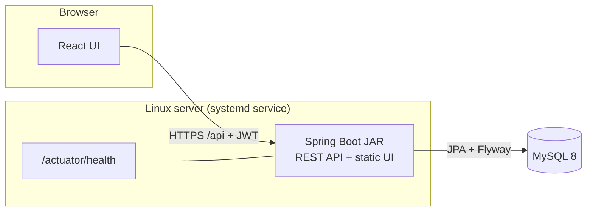
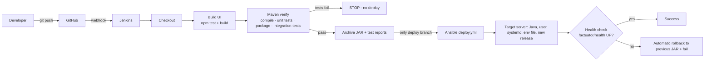

# End-to-End DevOps Pipeline for an Online Student Attendance System
**GitHub · Maven · Jenkins · Ansible**

> New here? Start with **[QUICK_START.md](QUICK_START.md)**. Honest build/test status: **[docs/VERIFICATION_STATUS.md](docs/VERIFICATION_STATUS.md)**.

## 1. Project overview
A web application where **administrators** manage students, faculty and courses, **faculty** record attendance for the courses they are
assigned to, and **students** view their attendance and percentages. A complete CI/CD pipeline builds, tests, packages and deploys it.

## 2. Problem statement
Manual attendance records and manual build/deploy steps cause errors, inconsistent servers and slow releases. This project combines a
database-backed attendance application with an automated pipeline so that every authorised code change is built, tested, packaged,
deployed and health-checked the same way every time.

## 3. Objectives
Web attendance app · Git/GitHub version control · Maven build & dependency management · Jenkins automated build/test on push ·
Ansible automated server configuration and deployment · repeatable, visible, low-manual-effort delivery (see PRD §3).

## 4. Architecture



**Pipeline**



## 5. Technology stack
Java 21 · Spring Boot 3.5 · Spring Security (JWT, BCrypt) · Spring Data JPA · Flyway · MySQL 8 · springdoc OpenAPI · JUnit 5/Mockito/MockMvc ·
React 18 + Vite · Maven · Jenkins (Declarative Pipeline) · Ansible · systemd. *No Docker/Kubernetes/Terraform – not needed.*
One deliberate choice: the React build is copied into the Spring Boot JAR, so deployment is **one file** and the UI and API share one origin.

## 6. Repository structure
```
├── Jenkinsfile                      pipeline
├── backend/                         Spring Boot (pom.xml, src/main, src/test, Flyway SQL)
├── frontend/                        React + Vite
├── ansible/                         ansible.cfg, inventory examples, playbooks/, roles/attendance_app, group_vars/
├── scripts/                         build-all.sh, run-local.sh, mysql-setup.sql
├── docs/                            DevOps guide, traceability matrix, test report template, API examples, rules, status
├── .env.example                     placeholders only
└── QUICK_START.md
```

## 7. Prerequisites
JDK 21, Maven 3.9+, Node 20/22, MySQL 8, Git. For the pipeline: Jenkins 2.4xx+, Ansible (core 2.15+), a Linux target (Ubuntu 22.04/24.04 or RHEL family, systemd).

## 8. Local installation · 9. Database setup · 10. Backend execution
See [QUICK_START.md](QUICK_START.md) steps 1–4. Flyway creates all tables on first start from `backend/src/main/resources/db/migration/V1__init_schema.sql`.
Initial accounts come from environment variables (`BOOTSTRAP_ADMIN_PASSWORD`, optional `SEED_DEMO_*`) – **no password exists in the repository**.

## 11. Frontend execution
`cd frontend && npm install && npm run dev` (http://localhost:5173, proxies `/api` to :8080). Production: bundled into the JAR by `scripts/build-all.sh` / Jenkins.

## 12. Maven build and test commands
```bash
cd backend
mvn clean test       # unit tests (*Test)
mvn clean package    # jar (unit tests run; integration tests do not)
mvn clean verify     # everything: unit + integration tests (*IT) – what Jenkins runs
```
Integration tests use in-memory H2 in MySQL mode with the real Flyway migrations (no MySQL needed). To run them against real MySQL:
`mvn verify -DargLine="-Dspring.datasource.url=jdbc:mysql://localhost:3306/attendance_test -Dspring.datasource.username=… -Dspring.datasource.password=… -Dspring.datasource.driver-class-name=com.mysql.cj.jdbc.Driver"` (use a scratch schema; each test rolls back).

## 13. GitHub repository setup
```bash
cd student-attendance-devops
git init -b main          # (already done in the zip; skip if .git exists)
git add . && git status   # confirm .env and *.key are NOT listed
git commit -m "Initial commit"
git remote add origin https://github.com/<you>/<repo>.git
git push -u origin main
```
Protect `main` in GitHub → Settings → Branches (require pull request). Work on feature branches; Jenkins builds and tests them but **deploys only `main`**.

## 14–15. Jenkins installation, configuration and execution · 16–18. Ansible and deployment
Exact commands: **[docs/DEVOPS_SETUP_GUIDE.md](docs/DEVOPS_SETUP_GUIDE.md)**.

## 19. Health verification
`GET /actuator/health` → `{"status":"UP"}` (includes database connectivity; no details exposed). `/actuator/health/liveness` = process alive,
`/actuator/health/readiness` = ready incl. DB. Ansible checks it after every deploy; Jenkins optionally re-checks via `APP_HEALTH_URL`.

## 20. Troubleshooting
| Symptom | Likely cause / fix |
|---|---|
| App won't start: `Could not resolve placeholder 'DB_PASSWORD'` / `JWT_SECRET` | Variables not exported – run via `./scripts/run-local.sh` or set them |
| `JWT_SECRET must be set and at least 32 characters` | Use a longer secret |
| `Access denied for user 'attendance_app'` | Wrong `DB_PASSWORD`, or step 2 not run |
| `Unsupported class file major version` / compile errors | Not on JDK 21 |
| Login says invalid credentials for admin | `BOOTSTRAP_ADMIN_PASSWORD` was empty on first start; set it and restart (admin is created when missing) |
| Pipeline: `tool type "jdk" does not have "jdk21"` | Create the tools in *Manage Jenkins → Tools* with exactly those names |
| Pipeline fails at deploy: `Host key verification failed` | Add host with `ssh-keyscan` as the jenkins user (guide §6) |
| Deploy fails with rollback message | Read the “Last log lines” printed by the playbook (usually DB password/URL) |
More in the DevOps guide.

## 21. Security considerations
BCrypt (cost 12) password hashing · stateless JWT (HS256, expiring, secret from env) · authorization enforced on the server (URL rules + `@PreAuthorize` +
per-course checks) · students can only reach their own data (no id parameter exists) · validation on every request · JPA/parameterised queries only (no SQL concatenation) ·
CORS limited to configured origins · safe JSON errors without stack traces · actuator limited to health/info · secrets only from env / Jenkins credentials /
root-only `0600` env file on the server · systemd hardening and unprivileged service user · SSH host-key checking on.
**Not production-ready as-is:** put it behind HTTPS (nginx/Caddy reverse proxy – not included), add login rate-limiting/lockout, use a separate DB migration account,
use Ansible Vault or a secret manager, passwordless sudo for the deploy user should be narrowed, and the whole system needs a proper security review/penetration test.
Tokens are kept in `sessionStorage` (readable by injected scripts – XSS is the main browser-side risk).

## 22. Acceptance criteria verification
See [docs/TRACEABILITY_MATRIX.md](docs/TRACEABILITY_MATRIX.md) (AC-01…AC-12 with the file, test and how to verify each). Test report template: [docs/TEST_REPORT_TEMPLATE.md](docs/TEST_REPORT_TEMPLATE.md).

## 23. Future enhancements
Docker packaging · HTTPS reverse proxy · SonarQube / dependency scanning · email/Slack notifications · blue-green deploys · Prometheus metrics ·
CSV/PDF export of reports · refresh tokens & login lockout · self-service password change.

## Key business rules (implemented)
Full detail: [docs/ATTENDANCE_RULES.md](docs/ATTENDANCE_RULES.md). Percentage = present ÷ (present + absent) of **HELD** classes only; cancelled/holiday classes and classes with no
record for a student are not counted; no classes → “N/A”; default low-attendance threshold 75 %; no future dates; edits only within 7 days; one record per student per class (DB unique constraints).
API examples: [docs/API_EXAMPLES.md](docs/API_EXAMPLES.md) · live docs at `/swagger-ui.html`.
